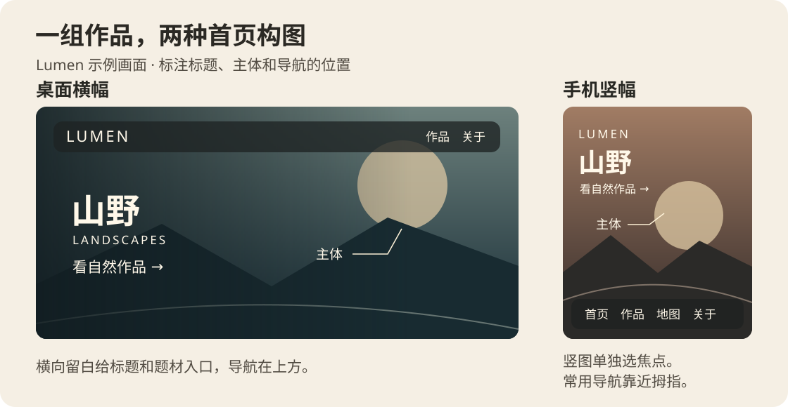

# KAI 摄影网站制作手册

把摄影作品排成一座能逛的展览。这里公开 KAI｜光陰之間的设计取舍、排版方法和可复用代码，供已经有网站和域名的读者使用。你可以先把一种封面、一篇相册或一个看图交互搬进自己的站点。

[看 KAI 成品](https://kai-guangyin-v2.pages.dev/) · [读制作手册](docs/制作方法.md) · [运行 Lumen](START_HERE.md)

## 按你想改的部分读

| 章节 | 可以带走什么 |
| --- | --- |
| [首页和视觉系统](docs/制作方法.md#首页和视觉系统) | 横竖封面、构图焦点、双语字阶、桌面导航和手机底栏 |
| [作品库和看图](docs/制作方法.md#作品库和看图) | 题材入口、图集排序、原画幅看图、单图直达和返回位置 |
| [地区索引和旅行相册](docs/制作方法.md#地区索引和旅行相册) | 地区索引、章节、专题和下一程的组织方法 |
| [唱片和跨页音乐](docs/制作方法.md#唱片和跨页音乐) | 两份独立原生 HTML/CSS/JS 小样 |
| [把内容接进已有网站](docs/制作方法.md#把内容接进已有网站) | 照片导入、稳定 ID、配置引用和接入检查 |
| [从参考到验收](docs/制作方法.md#从参考到验收) | 参考观察表、设计复盘与 AI 协作提示词 |

## 在本机看效果

下载源码并解压，在项目目录用 Python 3.10 或更高版本运行以下命令。macOS/Linux 上可用 `python3`。

~~~sh
python tools/serve.py
~~~

- [Lumen 首页](http://127.0.0.1:8000/index.html)
- [旅行唱片与可选立体模式](http://127.0.0.1:8000/examples/record-deck/index.html)
- [站内切页时连续播放](http://127.0.0.1:8000/examples/persistent-audio/index.html)

Lumen｜所见之集用十二张原创 SVG 示例画面和地区索引示意图演示页面。它包括首页、作品库、旅程、专题、地区索引和关于页，也提供手记、画框、书签和随机看图。单独取用时，从手册对应章节开始。替换整套内容时，按[换图和配置指南](docs/使用指南.md)操作。

## 导出与许可

~~~sh
python tools/check.py
python tools/build.py --output dist-portfolio
~~~

可以将生成的静态文件放到现有网站的摄影路径，保留文件间的相对位置。换图工具依赖 `requirements.txt` 中的 Pillow。测试和数据结构见[架构说明](docs/架构.md)。

自有模板代码、手册和原创示例素材采用 [MIT](LICENSE)。Hanken Grotesk 采用独立的 SIL OFL 1.1。使用者添加的照片、文字、地图数据和音源按各自权利与许可使用。 [第三方内容与许可](THIRD_PARTY_NOTICES.md)

