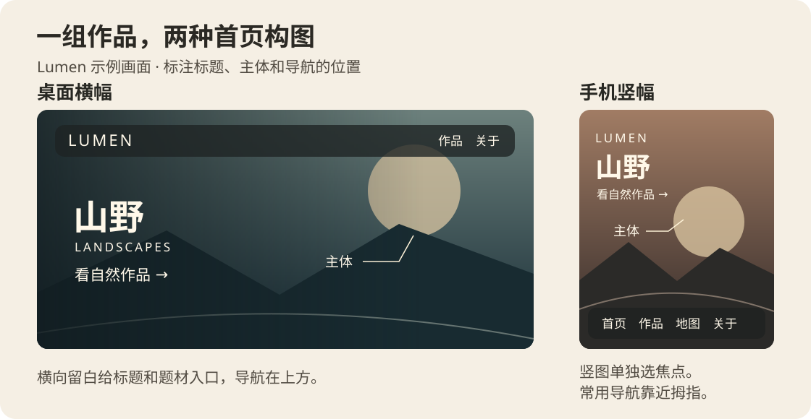
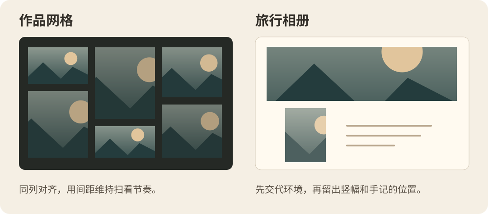
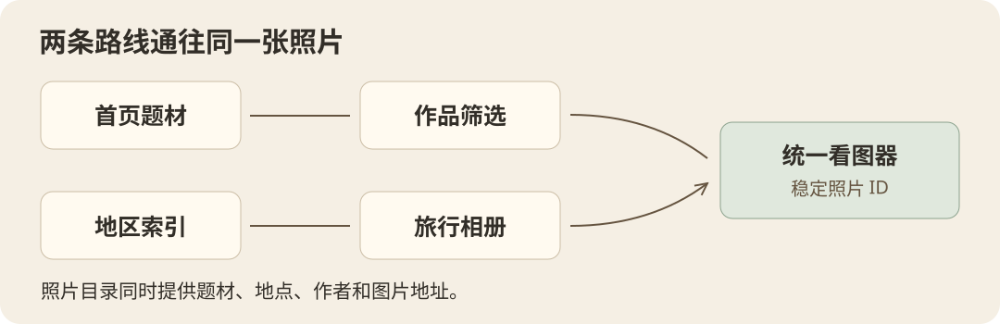

# 摄影网站的制作方法

[返回手册目录](../README.md)

KAI｜光陰之間把同一批照片组织成两条路线。想按题材观看的人从「入野」「穿城」「拾日」进入作品库，想从地点出发的人从地区索引或「行远」进入相册。首页展示作品的气质，列表帮助人找图，章节让人按作者编好的顺序读下去。

## 首页和视觉系统

**把照片和入口一起排。** KAI 桌面首张《微光与四姐妹》有横向空间，标题与入口可以落在画面较安静的一侧。手机竖屏换用《见山》，让作品主体在狭长视口仍可辨认。先找出照片主体和留给文字的区域，再定标题和渐变的位置。选图时先看全图，然后在目标宽度检查裁切。

**先排字阶和导航，再加质感。** 桌面半透明导航靠字重、间距和背景对比保持可辨。手机底栏放高频的全站入口，题材名称留在首页正文。中文衬线字建立标题层级，英文小字提供第二层信息，导航和正文用易扫读的无衬线或系统字体。先区分主标题、入口名和辅助说明，再决定字号。暖黑背景与纸白表面各用一张亮图和一张暗图校对，观察暗部层次和浅色主体边缘。

Lumen 可从暖黑 `#0f0e0c` 和纸白 `#efede7` 取色，标题使用 Georgia 与系统中文衬线字体，说明和导航用 Hanken 或系统无衬线。试字时把实际的题材词、英文副题和图注放到同一画面，看长词折行、细字对比和数字对齐。手机用真实短屏宽高验收底栏，固定底栏上方的正文和控件应能滚到可点击区域。 [样式源码](../lumen/styles/v2.css)

**搬到自己的站。** 在现有摄影页用 `picture` 为手机选择竖幅，放进组件作用域。下面的固定比例便于嵌入内页，KAI 首页采用整屏构图。

~~~html
<picture class="portfolio-cover">
  <source media="(max-width: 760px) and (orientation: portrait)"
          srcset="images/cover-vertical.jpg">
  
</picture>
~~~

~~~css
.portfolio-cover { display: block; aspect-ratio: 16 / 9; }
.portfolio-cover img { display: block; width: 100%; height: 100%; object-fit: cover; }
@media (max-width: 760px) and (orientation: portrait) {
  .portfolio-cover { aspect-ratio: 3 / 4; }
  .portfolio-cover img { object-position: 54% 50%; }
}
~~~

Lumen 可以直接改 `categories[].image`、`portrait` 与 `focus`。每次换题材都用同一组横竖封面。检查主体有没有被字挡住、导航能否看清、入口能否点到合适的下一页。 [封面配置](../lumen/site.config.js) · [窄屏样式](../lumen/styles/mobile-refinement.css)

Lumen 的第一组封面可以用以下配置试改焦点。把这段作为 `categories` 的一项，并保留其余分类。

~~~json
{
  "name": "山野",
  "en": "LANDSCAPES",
  "theme": "自然",
  "desc": "自然与远行",
  "image": "demo-01",
  "portrait": "demo-02",
  "focus": "54% 50%"
}
~~~

## 作品库和看图

**让分类和排序各有用途。** 分类回答「我想看什么」，顺序回答「先看哪几张」。KAI 按自然、城市、日常组织入口，再单独为每类选开头的作品。让环境、主体和细节交替出现。Lumen 的作品列表沿用照片目录中的记录顺序，把选中的作品移到同题材记录之前，保留每张照片的 `id`，再点对应题材检查开头几张。 [照片目录](../lumen/content/photos.js)

**列表支持扫看，看图器交给完整照片。** 网格用统一间距和对齐关系维持节奏。单图打开后按原画幅显示，把操作和可展开的手记、参数放在画面边缘。关闭时回到刚才的位置。分享地址用稳定 ID，例如 `works.html?author=kai&photo=demo-01`。作品改名或调整专题顺序后，旧分享链接仍找得到同一张。

**搬到自己的站。** 复用现有作品 ID 和列表路由，让单图入口读取参数，关闭时还原焦点。Lumen 的单图浏览在同一作者的作品中循环，专题正文按指定顺序排。检查筛选、空结果、直达链接、左右键、Escape 和触摸缩放。 [作品筛选](../lumen/scripts/gallery.js) · [看图源码](../lumen/scripts/viewer.js) · [双作者、手记、画框和参数](功能配置.md)

## 地区索引和旅行相册

**在地图之后给出清楚的入口。** 地区索引按作品归属汇总。选中后显示封面与相册入口，遇到多个地点或作者时给出列表。手机用下拉选择，桌面可以点地区图形。Lumen 使用原创地区索引图；现有站有地图组件时，可复用地区码和相册地址的对应关系。 [地图源码](../lumen/scripts/atlas.js) · [地区数据接入](使用指南.md#5-地区与地图)

**把相册排成章节。** 先选一张能读出地点气质的封面。正文按实际地点分段，或按第一标签把相近的照片聚成小节。横图交代环境，竖幅和细节延长停留，文字放在需要交代时间、地点或感受的位置。用内容、拍摄顺序或视觉呼应选下一程。跨地区专题可列出照片 ID 固定阅读顺序。 [相册源码](../lumen/scripts/photography.js) · [专题源码](../lumen/scripts/essays.js) · [下一程](../lumen/scripts/further.js)

**搬到自己的站。** 用 `provinceCode` 和 `place` 对作品分组，先选两个地区接到现有相册地址，再各排一个封面和开头三张照片。用手机和桌面走一遍选择地区、进相册和打开单图，核对作者、地点和封面。

## 唱片和跨页音乐

**旅行唱片。** KAI 把旅行做成可翻阅的唱片目录。选片、封面和相册链接在平面模式就能用。点击立体模式后，渲染层读取同一份选片状态。KAI 成品用 Swiper 和 WebGL，独立小样用 CSS `perspective` 和 `rotateY()`。先把封面链接和选择器接到自己的旅程页，再在按钮事件里导入立体模块。用键盘开关，检查当前封面、地点和链接是否指向同一程。 [唱片源码](../lumen/examples/record-deck/index.html) · [立体模块](../lumen/examples/record-deck/perspective.js)

**跨页音乐。** 把播放器放在共享页面壳，切页只更新主内容。KAI 保留各页的 HTML 直达入口，站内切换时复用公共播放器。小样用 `#works` 和 `#journey` 在同一文档中演示内容、历史和播放器的关系。接到现有路由时让播放器节点留在内容出口外。用原创短音源检查播放中切页、暂停后前进和后退。普通文档刷新会创建新的播放器。 [音乐源码](../lumen/examples/persistent-audio/index.html)

进入 `lumen/`，运行 `python tools/serve.py`，打开[唱片小样](http://127.0.0.1:8000/examples/record-deck/index.html)和[音乐小样](http://127.0.0.1:8000/examples/persistent-audio/index.html)。移植时接入自己的封面、相册地址和音源。按现有站点的样式作用域选用 [demo.css](../lumen/examples/demo.css) 中的基础样式，把示例导航绑定到自己的路由。

## 把内容接进已有网站

1. **从一页、两组照片开始。** 选一个现有摄影入口或旅游文章，记下它的链接。将代码限定在这页的样式范围，图片和相册用相对地址。
2. **共用一份作品目录。** Lumen 的 `id` 用于分享和专题，`image` 用于配置中的封面，目录还包含作者、地区、题材、尺寸和多档 URL。已有作品表的站点可映射这些字段并复用旧 ID。 [照片目录](../lumen/content/photos.js) · [站点配置](../lumen/site.config.js)
3. **网页使用副本。** 导入工具只读原图，接收 JPG/JPEG、PNG 和可读取的 WebP，校正方向和色彩，生成 480、1600、2560 像素长边上限的 JPEG。Pillow 提供 WebP 支持时同时生成缩略图和显示图的 WebP。网页副本剔除 EXIF/GPS，作品目录仍可保留选定的拍摄参数。公开前检查标题和参数。KAI 成品还使用 AVIF 派生规格。 [导入工具](../lumen/tools/import_photos.py)
4. **在现有站址验收。** 完整试用 Lumen 时，进入 `lumen/` 运行 `python tools/verify.py`，再运行 `python tools/build.py --output dist-portfolio`。把导出的文件放到现有站点的摄影路径，在这个路径下检查图片、字体、专题、单图直达。只移植一个模块时，在现有站预览它与同页原有样式和交互。 [完整换图步骤](使用指南.md)

## 从参考到验收

KAI 首页先用横幅带出山势，再在手机宽度比较原图裁切与单独竖幅。对照时用同一套入口与字阶，观察主体是否完整、文字是否遮挡、入口是否清楚、点下去是否有合理的下一步。最后用桌面《微光与四姐妹》和手机《见山》分别控制构图。

做自己的版本时，先写一条想改善的路线，例如「手机首页 → 城市照片 → 单图」。从参考里记录可观察的字号、照片比例、点击与返回行为，再做两个同宽方案。 [参考观察表](参考网站.md)

把选定的方案、它解决的观看问题和实际检查结果写进简报。一次改一个变量，前后差异更容易归因。需要 AI 帮你比较版式时，可以使用五课教程中第 2 课的提示词。 [项目简报](../skills/ai-photography-site/references/interview.md#可复制的简报格式) · [五课教程](AI协作流程.md)

